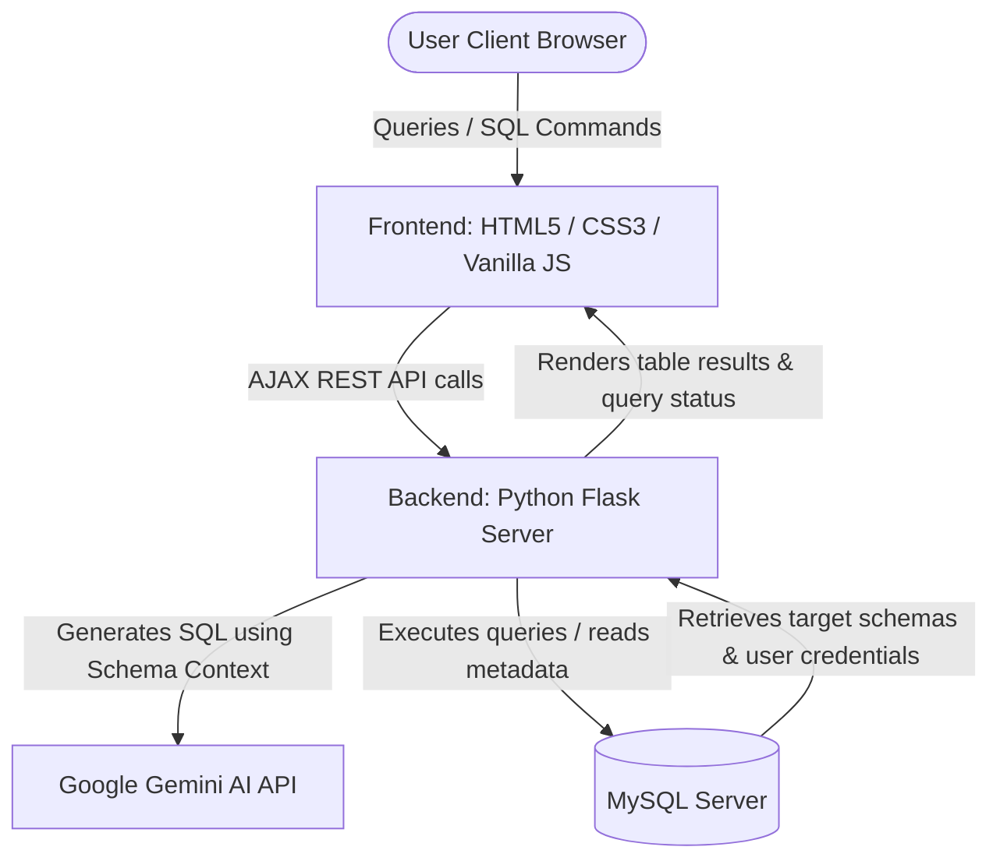
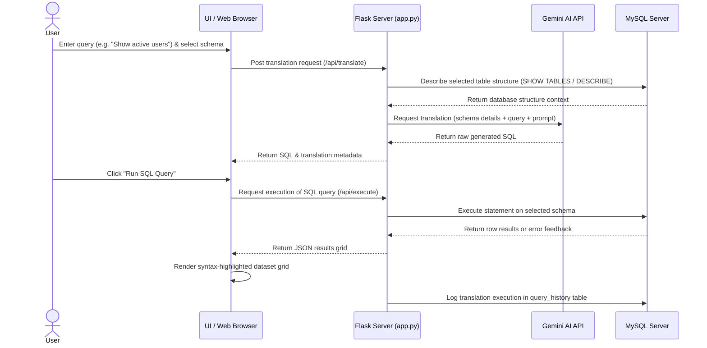
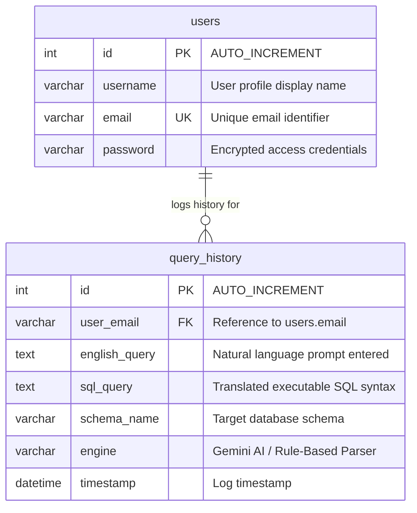

# TECHNICAL SYSTEM DOCUMENTATION

**QUERYCRAFT AI - INTELLIGENT ENGLISH-TO-SQL QUERY GENERATOR**  
*Comprehensive Technical System Documentation & Developer Guide*

---

## **1. AUTHOR IDENTIFICATION**

*   **Lead Developer:** Divya Prabha Shree N S
*   **Register Number:** 2303737714822045
*   **Department:** Computer Science & Engineering (Artificial Intelligence and Machine Learning)
*   **Institution:** K.S. Rangasamy College of Technology (Autonomous), Tiruchengode – 637 215
*   **Role:** Self-Directed Solo Project Developer & Architect

---

## **2. SYSTEM OVERVIEW**

**QueryCraft AI** is an advanced, full-stack database translation and query execution platform wrapped in a premium, retro-futuristic cyberpunk neon theme. The system bridges the gap between natural language instruction and structured relational databases, enabling non-technical users and developers to query databases using plain English.

### **Core Capabilities:**
1.  **Dual-Engine Translation**: Powered by the **Google Gemini 2.5-Flash API** for complex query translation with a fallback to a locally executed, rule-based **Python NLP parser** in case of offline usage or missing API keys.
2.  **Dynamic Schema Discovery**: Auto-detects all user-defined databases and tables running on a target MySQL server on startup, and renders their column schemas in an interactive sidebar explorer.
3.  **Interactive SQL Compiler Console**: Allows users to inspect the generated SQL syntax, edit queries on the fly, and run them live against selected databases.
4.  **Simulated Google OAuth Portal**: Integrates simulated Google One-Tap and credentials handling, allowing seamless login flow testing in local development environments.
5.  **Centralized History Persistence**: Logs translation history, target schemas, and processing engines under secure user sessions in a dedicated MySQL database.

---

## **3. SYSTEM ARCHITECTURE & DATA FLOW**

QueryCraft AI utilizes a modular client-server architecture consisting of a static/AJAX-driven web frontend and a Python Flask backend connected to a MySQL server.

### **3.1 Full-Stack System Architecture**



### **3.2 Execution Sequence Flow**



---

## **4. DATABASE SCHEMA DESIGN**

The application connects to a MySQL server and initializes a `history` database to persist session metadata. Target schemas containing user data (e.g. `ecommerce`, `saas`, `social`) are managed in parallel.



---

## **5. BACKEND CODE EXPOSITION (`app.py`)**

The Python backend is configured in `backend/app.py` as a lightweight Flask microservice.

### **5.1 Database Initialization & Connection Pooling**
```python
def get_mysql_connection(db_name=None):
    return pymysql.connect(
        host=os.environ.get('MYSQL_HOST', 'localhost'),
        user=os.environ.get('MYSQL_USER', 'root'),
        password=os.environ.get('MYSQL_PASSWORD', ''),
        database=db_name,
        port=int(os.environ.get('MYSQL_PORT', 3306)),
        cursorclass=pymysql.cursors.DictCursor,
        connect_timeout=6
    )
```
On server startup, `init_databases()` verifies that the MySQL connection is healthy and creates the `history` database along with the `users` and `query_history` tables if they do not exist.

### **5.2 Neural Engine & Fallback Translation**
If `GEMINI_API_KEY` is present in the environment variables, the translation is routed via the Gemini API using HTTP requests constructed with `urllib.request`. If offline or without a key, the backend falls back to `translate_english_to_sql_python()`, a rule-based translation helper that parses natural language instructions using regular expressions:

```python
# System prompt context template sent to Gemini API:
system_prompt = "You are a precise English-to-SQL translator for a MySQL database. Given the database schema, translate the English query into a single valid MySQL query. Return ONLY the raw SQL code. Do not include markdown code blocks, backticks, or any conversational text."
```

---

## **6. FRONTEND CODE EXPOSITION**

### **6.1 Cyberpunk Stylesheet (`styles.css`)**
The user interface features a premium dark-neon theme designed around glassmorphism panels. Theme variables are defined at the root of `backend/static/css/styles.css`:

```css
:root {
  --bg-primary: #0a0a16;
  --bg-panel: rgba(16, 16, 32, 0.7);
  --border-glow: #00ffcc;
  --text-neon: #39ff14;
  --accent-purple: #bd00ff;
  --glow-shadow: 0 0 15px rgba(0, 255, 204, 0.4);
}
```

### **6.2 Application Logic Flow (`app.js`)**
All frontend events are managed asynchronously in `backend/static/js/app.js`:
-   **Schema Discovery**: Executes a GET request to `/api/schema/definitions` to download all schema tables and populate the interactive column dropdowns.
-   **Query Execution**: Sends raw SQL drafts to `/api/execute` and renders returned JSON fields dynamically in a clean CSS grid.
-   **History Rendering**: Queries `/api/history` to load the current session's log history in the sidebar query log.

---

## **7. SYSTEM VERIFICATION & QUICK START**

### **7.1 Prerequisites**
*   Python 3.8+ installed.
*   Running MySQL Server instance.

### **7.2 Installation steps**
1.  Navigate to the project root directory:
    ```bash
    cd "d:\VS code programs\projects\eng to sql"
    ```
2.  Activate the virtual environment:
    ```bash
    .\venv\Scripts\activate
    ```
3.  Install the required dependencies:
    ```bash
    pip install -r backend/requirements.txt
    ```
4.  Configure your environment in `backend/.env`:
    ```ini
    FLASK_PORT=5000
    MYSQL_HOST=localhost
    MYSQL_USER=root
    MYSQL_PASSWORD=your_mysql_password
    GEMINI_API_KEY=your_gemini_api_key
    ```
5.  Launch the Flask backend:
    ```bash
    python backend/app.py
    ```
6.  Open a web browser and access `http://127.0.0.1:5000/`.

---

## **8. SUMMARY OF DEVELOPER OUTCOMES**

This application successfully demonstrates:
1.  **AI Integration**: Harnessing generative language models within database querying systems.
2.  **Dynamic Schemas**: Accessing and mapping schemas dynamically in a browser interface.
3.  **Secure Operations**: Utilizing credentials validation, database connection management, and simulated authentication flows.
